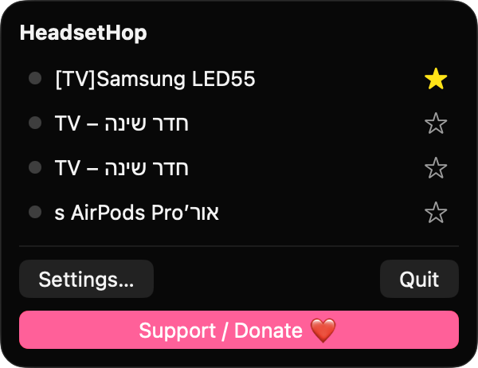
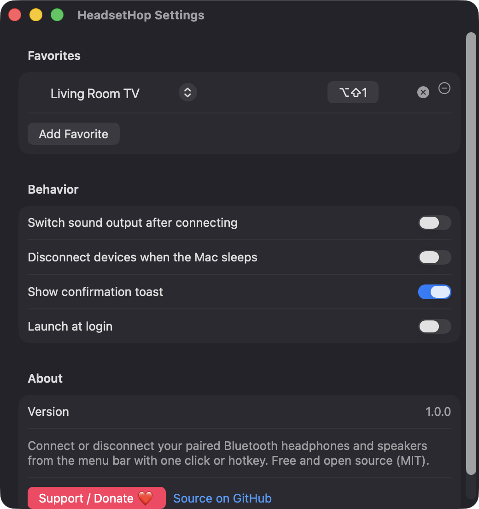
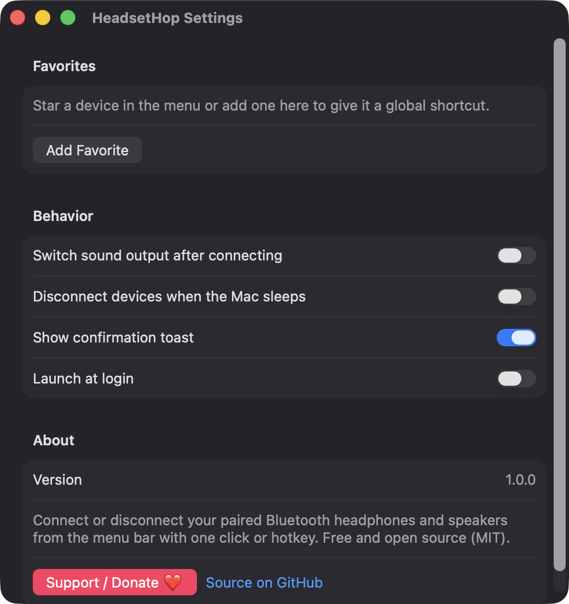

# HeadsetHop

**🌐 Website:** [turhe123.github.io/headset-hop](https://turhe123.github.io/headset-hop/)

Connect or disconnect your paired Bluetooth headphones and speakers from the menu bar with one click or hotkey.

> 🆓 A free, open-source **ToothFairy alternative** for macOS 14+. Native Swift, no accounts, no subscriptions, MIT licensed.


## Why

HeadsetHop is a free, open-source, 100% native, backend-free alternative to paid utilities in the *Audio* category. It was inspired by ToothFairy ($6.99 one-time), which showed how useful a one-click Bluetooth reconnect is. The built-in Bluetooth menu takes several clicks to do the same thing. HeadsetHop has no accounts, no servers and no analytics. It talks only to the Bluetooth stack on your Mac.

## Features

- **Menu bar app** (no Dock icon). The icon is `headphones` normally and `headphones.circle.fill` when any favorite device is connected.
- **Lists every paired Bluetooth audio device**, detected by the Audio major device class or the Audio service-class bit, sorted by name, with a green/grey connection dot.
- **One-click toggle**: click a row to connect or disconnect. Connections run off the main thread, with a spinner while busy.
- **Automatic retry**: a failed connect is retried once, which helps with devices still attached to another Apple device.
- **Favorites**: star up to 5 devices. Each favorite can have its own **global hotkey** (Carbon `RegisterEventHotKey`), recorded in Settings. A conflicting shortcut shows "Shortcut already in use".
- **Switch sound output after connecting** (optional): sets the device as the default output with CoreAudio, retrying for about 3 seconds while the audio device appears.
- **Disconnect on sleep** (optional): disconnects connected devices when the Mac goes to sleep.
- **Confirmation toast** (optional, on by default) for success or failure.
- **Launch at login** via `SMAppService`. The toggle reflects the real status and tells you if approval is needed in Login Items.
- **Live sync**: listens for Bluetooth connect/disconnect notifications and also refreshes every 15 seconds and whenever the menu opens.
- **Helpful empty states**: Bluetooth off, Bluetooth permission denied, or no paired audio devices each show a message and a button that opens the right System Settings pane.
- Devices are keyed by hardware address, so renamed devices keep their favorite and hotkey.
- A visible **Support / Donate ❤️** button in the menu and in Settings.

## Screenshots

<p align="center"></p>

<p align="center"><em>The HeadsetHop menu bar popover lists every paired Bluetooth audio device with a connection dot and a favorite star, so one click connects or disconnects it.</em></p>

<p align="center"></p>

<p align="center"><em>In Settings, a favorite device gets its own global keyboard shortcut, shown here as Option-Shift-1.</em></p>

<p align="center"></p>

<p align="center"><em>The Settings window, with options to switch sound output, disconnect on sleep, show a confirmation toast and launch at login.</em></p>

## Install

1. Download `HeadsetHop-macOS.zip` from the [latest release](https://github.com/turhe123/headset-hop/releases/latest).
2. Unzip it and move `HeadsetHop.app` to `/Applications`.
3. The app is open source and not notarized, so clear the quarantine flag:

   ```bash
   xattr -cr /Applications/HeadsetHop.app
   ```

4. Right-click the app → **Open** the first time you launch it.

Requires macOS 14.0 or later.

## Build from source

```bash
brew install xcodegen
xcodegen generate
xcodebuild -project HeadsetHop.xcodeproj -scheme HeadsetHop -configuration Release -derivedDataPath ./build build
```

The app is produced at `build/Build/Products/Release/HeadsetHop.app`. There are no third-party Swift packages. The app uses SwiftUI, AppKit, IOBluetooth, CoreBluetooth, CoreAudio, ServiceManagement and Carbon.

## Permissions

- **Bluetooth** (the only permission prompt): macOS asks the first time the app runs. HeadsetHop needs it to list, connect and disconnect your paired devices. If you deny it, re-enable it in System Settings › Privacy & Security › Bluetooth. The app links there.
- **Login Items** (only if you enable "Launch at login"): macOS may ask you to approve HeadsetHop in System Settings › General › Login Items.

HeadsetHop does **not** request Accessibility, Screen Recording or Microphone access. Global hotkeys use Carbon's `RegisterEventHotKey`, which needs no special permission.

## Support ❤️

HeadsetHop is free and always will be. If it saves you some clicks, you can support its development:

[%20Davidai%20❤️-ff5e5b?logo=ko-fi&logoColor=white)](https://ko-fi.com/leodavidai)

→ https://ko-fi.com/leodavidai

## More free Mac apps

HeadsetHop is one of [60 free, open-source Mac utilities](https://github.com/turhe123/mac-apps) built the same way: native Swift, no accounts, no telemetry. Browse the full gallery at [turhe123.github.io/mac-apps](https://turhe123.github.io/mac-apps/).

## License

MIT © Or Davidai Bachar
